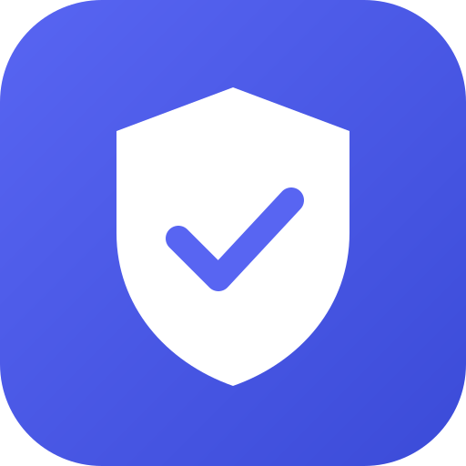

<p align="center">
  
</p>

<h1 align="center">Discord Verify Bot</h1>

<p align="center">
  Open-source human verification for Discord.<br>
  Members click a button, pass a Cloudflare Turnstile check, and receive a role.
</p>

<p align="center">
  <a href="LICENSE"></a>
  <a href="SECURITY.md"></a>
</p>

---

## Why this bot

- **Open source.** Every line that runs on the verification server is in this repository.
- **No personal data stored.** No IP addresses, emails, or tokens are kept. See [PRIVACY.md](PRIVACY.md).
- **Free to run.** Built on Cloudflare Workers and Turnstile free tiers.
- **Simple setup.** One slash command creates the verification message.

## Add the bot to your server

1. Open this link and choose your server (you need the **Manage Server** permission):

   <https://discord.com/oauth2/authorize?client_id=1568336029264388186&scope=bot+applications.commands&permissions=268437504>

2. In **Server Settings → Roles**, drag the bot's role above the role it will grant.

## Setup

Run this in any channel:

```
/setup channel:#verify verified_role:@Verified unverified_role:@Unverified
```

| Option | Required | Description |
| --- | --- | --- |
| `channel` | Yes | Where the verification message will be posted |
| `verified_role` | Yes | Role granted after successful verification |
| `unverified_role` | No | Role removed after verification |

**Recommended:** Deny *View Channel* for `@everyone` and allow it only for `@Verified`. New members will then see only the verification channel.

## How it works

1. A member clicks **Verify** on the message.
2. The verification page checks the member with Cloudflare Turnstile.
3. Discord asks the member to authorize the `identify` scope, which provides only the user ID.
4. The bot grants the verified role and removes the unverified role, if set.

## Privacy and security

- [PRIVACY.md](PRIVACY.md): what is and is not stored.
- [SECURITY.md](SECURITY.md): how to report vulnerabilities privately.
- Releases are tagged. Compare the running version with the code at the matching tag.

## Limits

Verification raises the cost of spam accounts but cannot guarantee that a user is a real person. Treat it as one layer of moderation, not a complete solution.

## Contributing

Issues and pull requests are welcome. For security problems, please follow [SECURITY.md](SECURITY.md) and do not open a public issue.

## License

[MIT](LICENSE)